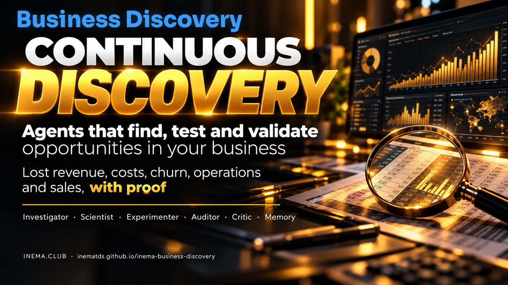

# INEMA Business Discovery

[](https://inematds.github.io/inema-business-discovery/guia/en/)

**🇧🇷 [Português](README.md) · 🇺🇸 [English](README.en.md) · 🇪🇸 [Español](README.es.md)**

## What it is

INEMA Business Discovery is an open program that reads your company spreadsheets (sales, customers, proposals, expenses, and operations) and points out opportunities: customers who stopped buying, expenses that rose too much, rework, and sales that could have happened. It is for small and medium sized business owners or managers who want to make decisions based on evidence, not guesswork. Each finding includes the calculation, confidence level, and a test to confirm it. All you need is Python 3 and spreadsheets exported as CSV files.

## 📖 User guide

Full guide (landing page + step-by-step instructions): **https://inematds.github.io/inema-business-discovery/guia/en/**

**A discovery lab for business management.** Six agents investigate company data, find opportunities the manager has not yet seen, propose hypotheses, plan tests with a control group, check the calculations, try to disprove their own conclusions, and save what they learn.

> What if a company had a team of AI researchers working around the clock, not to answer the manager’s questions, but to keep discovering how it could earn more, spend less, and operate better?

- Explainer course: https://inematds.github.io/business-discovery-v72/ (in Portuguese)

## In 1 minute

```bash
git clone https://github.com/inematds/inema-business-discovery
cd inema-business-discovery
python3 -m bd demo                       # FICTITIOUS company, full cycle
python3 -m bd servir --saida saida-demo  # dashboard at http://127.0.0.1:8765
```

You only need Python 3.10+. No external dependencies and no API key.

The demo reproduces the example from the vision document: **120 inactive customers × 20% conversion × R$ 3,500 average sale = R$ 84,000 in potential revenue; × 30% margin = R$ 25,200 in potential contribution.** This is an illustrative scenario with invented data—not an observed result. The demo test is also **simulated**.

## The agent team

| Agent | What it does | In LOOP-R |
|---|---|---|
| **Investigator** | Scans the 5 areas and finds patterns, anomalies, and opportunities. Calculations only; no language model. | Locate |
| **Scientist** | Forms hypotheses and interventions; has 3 agents compete with different strategies. | Propose |
| **Experimenter** | Simulates scenarios (pessimistic, base, optimistic) and selects test and control groups at random. | Operate |
| **Auditor** | Recalculates each figure from the inputs, checks that targets exist and that evidence is available. Rejects anything that does not add up. | (verification) |
| **Critic** | Looks for alternative explanations and signs of inflated numbers; lowers confidence. | (verification) |
| **Memory** | Saves findings, decisions (who, when), and lessons. Only validated strategies are promoted. | Reinforce |

The **Validator** compares forecasted results with measured results using the control group — LOOP-R: Observe.  
LOOP-R rule: **the person who does the work is never the one who evaluates it.**

## The five areas

| Area | What it looks for (in this version) |
|---|---|
| Lost revenue | customers who stopped buying; proposals forgotten in the CRM |
| Avoidable expenses | recurring expenses that rose by more than 10%; two suppliers for the same thing |
| Churn risk | active customers taking longer than usual to return |
| Operational inefficiencies | the step responsible for the most rework; time bottlenecks |
| Sales opportunities | products bought together (cross-selling); items with very low margins |

Each finding includes: data source, time period, hypothesis, evidence, reproducible calculation, assumptions, risks, confidence level, cost, priority, and next step.

## Competing agents, blind evaluation

For each finding, three agents suggest ways forward (for example, **A Recovery** — personalized outreach; **B Offer** — targeted discount; **C Relationship** — a benefit without changing the price). The evaluator receives the proposals in shuffled order as “Proposal 1, 2, 3,” without knowing who made each one, and scores them based on net contribution after accounting for risk. The authors are revealed afterward. A strategy that has already been validated in tests gets a bonus in future rounds.

## Governance: a human approves

Customer outreach, discounts, pricing, contracts, and process changes **only move forward with a person’s approval** (`python3 -m bd aprovar ID --por "Name"` or the dashboard button). An agent cannot approve: names such as “agent” or “cycle” are rejected. Without approval, the Validator refuses to validate. Everything is recorded in the decision log.

## Use it with your data

Export spreadsheets from your CRM, finance system, and operations system to a folder (`;` or `,` delimiters, dates in `yyyy-mm-dd` or `dd/mm/yyyy` format, values such as `1.234,56` are accepted):

| File | Columns |
|---|---|
| `vendas.csv` (required) | venda_id, data, cliente_id, produto_id, quantidade, valor |
| `clientes.csv` | cliente_id, nome, segmento, cidade, desde |
| `produtos.csv` | produto_id, nome, categoria, preco, custo |
| `propostas.csv` | proposta_id, cliente_id, data, valor, status, ultimo_contato |
| `despesas.csv` | data, fornecedor, categoria, valor, recorrente, contrato_fim |
| `operacao.csv` | pedido_id, data, etapa, horas, retrabalho |

A missing file only disables the corresponding area. Assumptions (margin, conversions, hourly cost) go in a `config.json` file in the same folder — see `exemplos/empresa-ficticia/config.json` and `bd/config.py`.

## The process, from start to finish

🧠 manager session · ⚙️ script · 🤖 agent/model

1. 🧠 **Export the data** from your CRM, finance system, and operations system to a folder (CSV). No integration is needed for the first pilot.
2. 🧠 **Write the assumptions** in `config.json`: contribution margin, expected conversion rates, hourly cost.
3. ⚙️ **Run the cycle**: `python3 -m bd analisar --dados minha-pasta --saida saida` — Investigator, Scientist, Experimenter, Auditor, and Critic run in sequence.
4. 🤖 *(optional)* **Narrative**: with `--llm` and `"llm": {"provedor": "ollama"}` in the config, a local model explains each finding in plain English.
5. 🧠 **Read the report** (`saida/relatorio.html`) or open the dashboard: `python3 -m bd servir --saida saida`.
6. 🧠 **Approve or reject** each test: `python3 -m bd aprovar RP-REATIVACAO --por "Your Name"`.
7. 🧠 **Run the test** with the groups selected at random in `saida/planos/<ID>-grupos.csv` (only the “test” group receives the action).
8. 🧠 **Record the result** in a CSV file: `alvo_id, grupo, converteu, receita`.
9. ⚙️ **Validate**: `python3 -m bd validar RP-REATIVACAO --resultados resultado.csv --saida saida` — calculates incremental contribution, the p-value, and forecast accuracy.
10. ⚙️ **Reinforce**: a strategy that passes (p < 0.05 and incremental profit) becomes a promoted lesson and carries more weight in the next cycle; everything else is recorded as discarded.
11. ⚙️ **Repeat** every week with new data (cron, systemd, or n8n — `n8n/business-discovery.json`). Previous human decisions are preserved.

## Metrics to prove results

`python3 -m bd memoria --saida saida` shows: validated opportunities, measured incremental impact, hypothesis accuracy (forecast vs. actual), completed tests, and findings by status.

## Language model: optional and local

The engine (calculations, auditing, statistics) **does not use a model**. The model only writes the explanation for the manager. Providers: `nenhum` (default), `ollama` (local), `claude-cli` (`claude -p` through your subscription), and `codex-cli` (`codex exec` through your subscription). None reads an API key, and only aggregated numbers are sent—no customer names leave the machine.

## Architecture and next steps

Today: plain Python + SQLite + HTML. The roadmap in the vision document (details in [docs/ARQUITETURA.md](docs/ARQUITETURA.md)):

- **Supabase**: `schema.sql` already includes tables for storing history in Postgres.
- **n8n**: the example workflow in `n8n/` runs the cycle every week and alerts anyone who needs to approve.
- **Next.js**: a multiuser web dashboard using the same `descobertas.json`.
- **Phase 2**: direct connectors for costs, margins, and operations.
- **Phase 3**: learning across companies, using only aggregated and anonymized data, with a legal basis, contract, and compliance with Brazil’s LGPD data protection law.

## Tests

```bash
python3 -m pytest -q   # 22 tests: document calculations, auditing, human approval gate, blind evaluation, validation
```

## License

MIT. The sample data is entirely fictional.